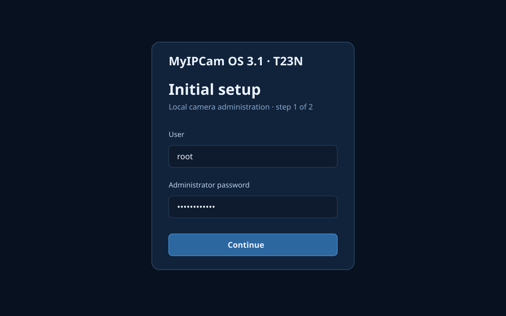
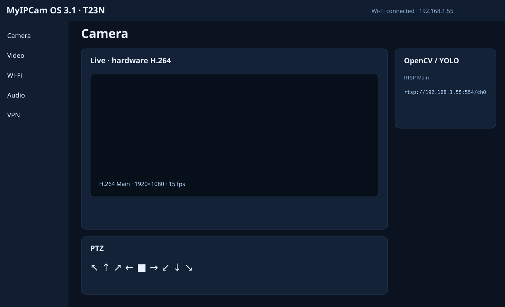

# MyIPCam OS 3.1 — T23/T23N microSD boot test

Experimental local-first IP camera firmware project for the **GV-T23-PTZ-MAIN-V2.0** board family.

> Status: **hardware test / Stage2**. This is not yet the final minimal MyIPCam OS.

Languages: [Русский](docs/i18n/README.ru.md) · [中文](docs/i18n/README.zh-CN.md) · [Српски](docs/i18n/README.sr.md) · [Беларуская](docs/i18n/README.be.md) · [Қазақша](docs/i18n/README.kk.md)

## What this project proves

This test platform boots from **microSD** on Ingenic **T23/T23N** hardware and does not depend on SPI NOR as the active boot medium. On the lab camera the original **PUYA P25Q64SH** SPI NOR was physically removed before the successful microSD-only boot tests.

This repository documents the resulting firmware and software workflow. It is **not a soldering tutorial**.

Verified on the target board:

- microSD boot using native **1-bit MMC**;
- Wi-Fi association;
- SC2336 video;
- hardware H.264;
- PTZ control;
- MyIPCam web administration page.

## Tested hardware baseline

- PCB: `GV-T23-PTZ-MAIN-V2.0` (`20230915`)
- SoC: Ingenic T23/T23N
- sensor donor profile: SC2336
- Wi-Fi donor profile: AltoBeam ATBM6012BX
- PTZ driver: ULN2803LV
- original SPI NOR: PUYA P25Q64SH, 64 Mbit / 8 MB
- microSD: CLK/CMD/DAT0, **1-bit MMC**
- compatible donor profile: `galayou_g2_t23n_sc2336_atbm6012bx`

The Galayou G2 name is a compatible software profile only; it is not proof of the retail camera model.

## Current architecture

```text
T23 BootROM
 -> SPL / U-Boot on microSD
 -> Linux
 -> ext4 rootfs on microSD
 -> camera / Wi-Fi / PTZ services
 -> MyIPCam Web UI
```

Stage2 intentionally reuses the already proven Thingino kernel/drivers/backend pieces. The final MyIPCam goal is a smaller appliance rootfs with only the services needed by the camera.

## SD image layout

- sector 34 / `0x4400`: SPL
- p1: FAT, starts at sector 2048
- p2: ext4, starts at sector 34816
- current test image: 85 MiB
- project hard limit: 128 MiB

## Build

Requirements: Linux/WSL, Python 3, `debugfs`, `e2fsck`, and the known-good donor build output.

```bash
chmod +x build-stage2.sh tests/run.sh
./build-stage2.sh
./tests/run.sh
```

To validate a built image too:

```bash
./tests/run.sh /path/to/MyIPCam_OS_3.1_T23N_stage2.bin
```

## Current Stage2 limitations

Audio/microphone controls, archive management, WireGuard/AmneziaWG UI and the final independent MyIPCam backend are still work in progress.

## Runtime observation

With the browser live view closed, one camera snapshot showed roughly **90% CPU idle**. Earlier, with the live web view open, `uhttpd`, `prudynt` and the local streaming proxy path consumed noticeably more CPU. This makes the live-view proxy chain an important Stage3 optimization target.

See [docs/PERFORMANCE.md](docs/PERFORMANCE.md).

## UI previews





These are generated UI documentation previews, not proof of a live camera frame.

## Search terms

MyIPCam, IP camera firmware, Ingenic T23, T23N camera, GV-T23-PTZ-MAIN-V2.0, microSD boot camera, SD card firmware, SPI NOR replacement experiment, SC2336, ATBM6012BX, PTZ camera, local camera without cloud.
