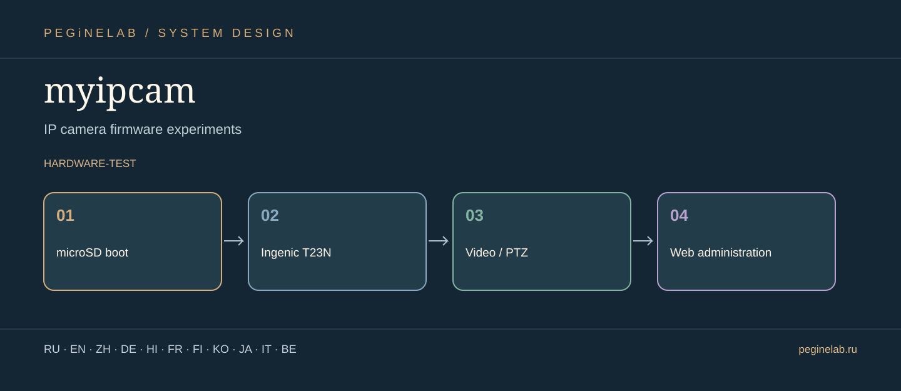

# myipcam — Visual project presentation

**Прошивка и эксперименты IP-камер · IP camera firmware experiments**

**Project flow:** microSD boot → Ingenic T23N → Video / PTZ → Web administration. **Status:** hardware-test.

**Translations:** documentation showcase only; interface localization and actual device tests are described independently in this project's README.

### Русский · ru
MyIPCam OS: локальная экспериментальная ОС IP-камеры.. **myipcam:** microSD boot → Ingenic T23N → Video / PTZ → Web administration.

### English · en
MyIPCam OS: experimental local-first IP camera operating system.. **myipcam:** microSD boot → Ingenic T23N → Video / PTZ → Web administration.

### 简体中文 · zh
MyIPCam OS：本地优先的实验性网络摄像头系统。. **myipcam:** microSD boot → Ingenic T23N → Video / PTZ → Web administration.

### Deutsch · de
MyIPCam OS: experimentelles lokales IP-Kamera-System.. **myipcam:** microSD boot → Ingenic T23N → Video / PTZ → Web administration.

### हिन्दी · hi
MyIPCam OS: स्थानीय IP कैमरे के लिए प्रयोगात्मक सिस्टम।. **myipcam:** microSD boot → Ingenic T23N → Video / PTZ → Web administration.

### Français · fr
MyIPCam OS : système expérimental de caméra IP locale.. **myipcam:** microSD boot → Ingenic T23N → Video / PTZ → Web administration.

### Suomi · fi
MyIPCam OS: kokeellinen paikallinen IP-kamerajärjestelmä.. **myipcam:** microSD boot → Ingenic T23N → Video / PTZ → Web administration.

### 한국어 · ko
MyIPCam OS: 로컬 IP 카메라용 실험적 운영체제.. **myipcam:** microSD boot → Ingenic T23N → Video / PTZ → Web administration.

### 日本語 · ja
IP カメラファームウェア実験. **myipcam:** microSD boot → Ingenic T23N → Video / PTZ → Web administration.

### Italiano · it
Esperimenti firmware per telecamere IP. **myipcam:** microSD boot → Ingenic T23N → Video / PTZ → Web administration.

### Беларуская · be
Эксперыменты з прашыўкай IP-камер. **myipcam:** microSD boot → Ingenic T23N → Video / PTZ → Web administration.

## Контакты / Contact

Telegram: [@Feudorlab1](https://t.me/Feudorlab1) · Phone: [+7 926 041 1145](tel:+79260411145)

Email: [feudor.lab@yandex.ru](mailto:feudor.lab@yandex.ru), [obzorniky@gmail.com](mailto:obzorniky@gmail.com) · [peginelab.ru](https://peginelab.ru/)

[Repository](https://github.com/musikfed/myipcam) · Technical README is authoritative; experimental features are not certified.
